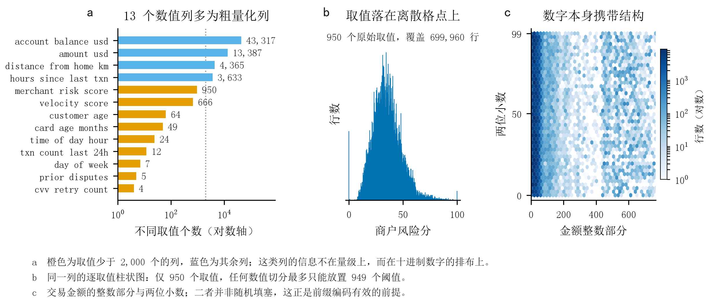
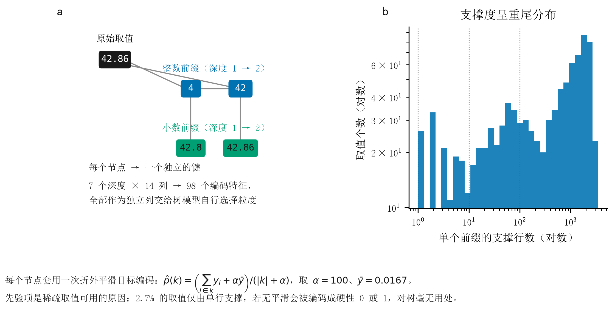
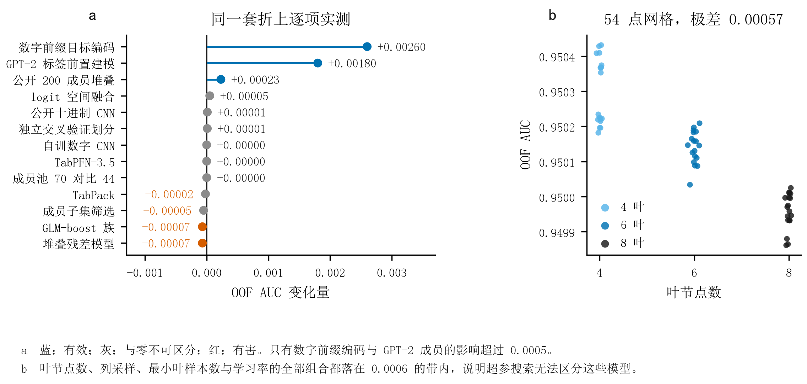
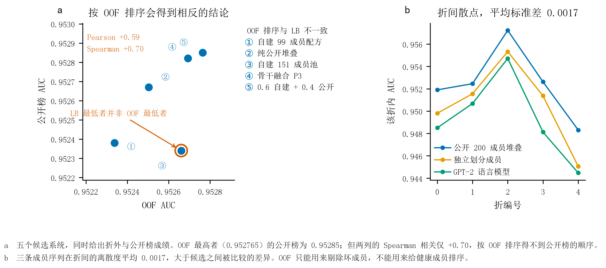
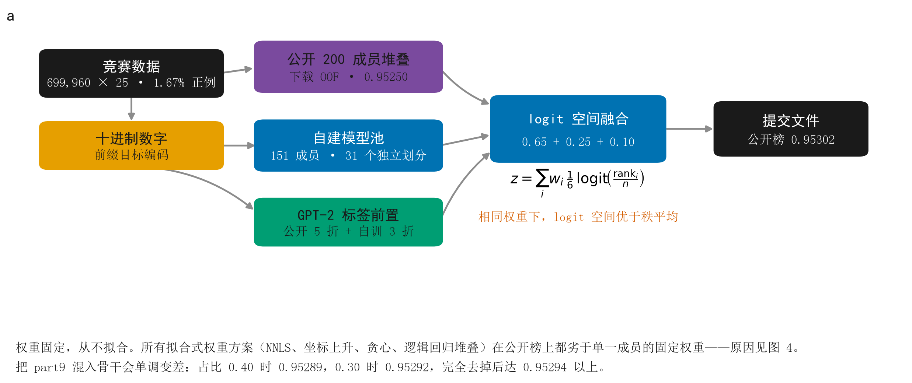
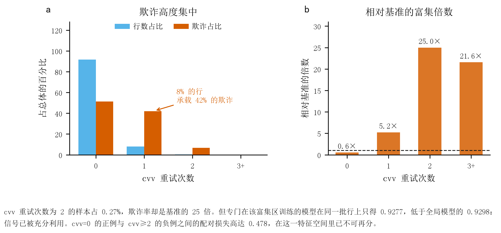
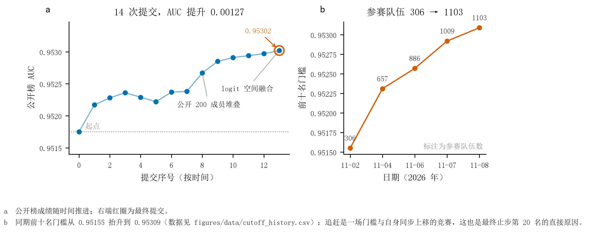

# Playground S6E11 · 信用卡欺诈检测

Kaggle [Playground Series S6E11](https://www.kaggle.com/competitions/playground-series-s6e11)
的完整记录：什么有效、什么无效，以及一个反复被验证的方法论教训。

**最终公开榜 0.95302（ROC AUC），排名 20 / 1103。**
起点 0.94647，排名 413 / 571。

本仓库最有价值的部分大概是那份 45 项以上的**证伪清单**——这个比赛的公开方案大多在互相重复，
而失败记录反而稀缺。

---

## 目录

| 图 | 内容 |
|---|---|
| [图 1](#图-1--为什么数字成为信息载体) | 特征量化：为什么十进制数字比量级更有信息 |
| [图 2](#图-2--数字前缀编码) | 数字前缀编码（Trie）与平滑的必要性 |
| [图 3](#图-3--每条路线的实测贡献) | 每条路线的实测贡献，以及超参搜索的天花板 |
| [图 4](#图-4--核心方法论发现) | 核心发现：OOF 无法给候选排序 |
| [图 5](#图-5--最终方案) | 最终方案的数据流 |
| [图 6](#图-6--结构性盲区) | 结构性盲区：欺诈高度集中却不可再分 |
| [图 7](#图-7--全程轨迹) | 全程轨迹与门槛的同步上移 |

---

## 问题

| | |
|---|---|
| 任务 | 二分类 |
| 指标 | ROC AUC |
| 训练集 | 699,960 行 × 25 特征 |
| 测试集 | 299,984 行 |
| 正例率 | 1.67%（11,689 个正例）|
| 奖励 | 3 Swag（无现金）|

数据由一份 20,000 行的源信用卡数据集合成而来，特征是**量化**的：
`merchant_risk_score` 在 70 万行里只有 **950 个不同取值**，`velocity_score` 666 个，
`distance_from_home_km` 4,365 个。所有数值列**最多两位小数**。

这个量化性质是整个解法的基础。



### 图 1 — 为什么数字成为信息载体

- **a** 橙色是取值少于 2,000 个的列。这类列的信息不在量级上，而在十进制数字的排布上。
- **b** 同一列的逐取值柱状图：只有 950 个层级，任何数值切分最多只能放 949 个阈值。
- **c** 交易金额的整数部分与两位小数。二者并非随机填塞——这正是前缀编码有效的前提。

---

## 图 2 — 数字前缀编码

把每个数值拆成十进制前缀，每个前缀成为一个独立的键，套用折外平滑目标编码：

```
42.86  →  整数前缀 "4", "42"
          小数前缀 "42.8", "42.86"
```



- **a** 每个节点 → 一个独立的键。7 个深度 × 14 列 → 98 个编码特征。
- **b** 支撑度呈重尾分布：26.4% 的前缀仅由单行支撑，因此原始目标均值不可用。

平滑是这套方法能工作的原因：

$$\hat{p}(k)=\frac{\sum_{i\in k}y_i+\alpha\bar{y}}{|k|+\alpha},\qquad \alpha=100,\ \bar{y}=0.0167$$

只出现一次的键，若无平滑会被编码成硬性 0 或 1，对树毫无用处。

**这一项带来 +0.0026，是所有特征工程里唯一真正有效的手段。**

---

## 图 3 — 每条路线的实测贡献



- **a** 蓝：有效；灰：与零不可区分；红：有害。只有数字前缀编码与 GPT-2 成员的影响超过 0.0005。
- **b** 54 点超参网格：叶节点数、列采样、最小叶样本数、学习率的全部组合都落在 0.0006 的带内。

超参搜索在这个问题上已经耗尽。**54 个网格点无一超过数字前缀编码的前沿。**

---

## 图 4 — 核心方法论发现



这是整个项目里最重要的一张图。

- **a** 五个候选系统，同时给出折外成绩与公开榜成绩。自建 151 成员池的 OOF 最高（0.952661），
  公开榜却最差（0.95234）；OOF 居中的方案反而最好。
- **b** 原因：单个折内成员之间的差异，大于候选之间被比较的差异。

**OOF 只能用来剔除坏成员，不能用来给健康成员排序。**

由此得到一条硬性结论：**所有权重拟合方案都失败**。NNLS、坐标上升、贪心选择、逻辑回归堆叠、
残差回归，在公开榜上全部劣于单一成员的固定权重。

| 提交 | OOF | OOF 名次 | 公开榜 | 公开榜名次 |
|---|---|---|---|---|
| 0.6 自建 + 0.4 公开 | **0.952765** | 1 | **0.95285** | 1 |
| 骨干融合 P3 | 0.952693 | 2 | 0.95282 | 2 |
| 自建 151 成员池 | 0.952661 | 3 | **0.95234** | 5 |
| 纯公开堆叠 | 0.952504 | 4 | 0.95267 | 3 |
| 自建 99 成员配方 | 0.952338 | 5 | 0.95238 | 4 |

两列的 **Spearman 相关仅 +0.70**（Pearson +0.59）：OOF 名次第 3 的方案在公开榜垫底，
而 OOF 第 4 的方案排公开榜第 3。**按其中一列排序，得不到另一列的顺序。**

---

## 图 5 — 最终方案



```
0.65 × 公开 200 成员堆叠
0.25 × 自建配方（堆叠 0.80 + 公开 CNN 0.06 + 独立划分成员 0.14）
0.10 × GPT-2 标签前置成员

三路在 logit 空间融合
```

两个必须记住的细节：

1. **必须用 logit 空间，不能用秩平均。** 相同权重下秩平均 0.95297，logit 空间 **0.95302**。
2. **不要把 part9 混进骨干。** 实测单调变差：0.40 → 0.95289，0.30 → 0.95292，完全去掉 → 0.95294 以上。

权重全部固定，从不拟合。

---

## 图 6 — 结构性盲区



AUC 是配对指标，而 **48.76% 的欺诈集中在 8.27% 的行里**（`cvv_retry_count ≥ 1`）。

`cvv = 2` 的样本占 0.27%，欺诈率是基准的 25 倍。但专门在该富集区训练的模型
在同一批行上只得 0.9277，低于全局模型的 0.9298。

进一步测量：`cvv=0` 的正例与 `cvv≥2` 的负例之间的配对损失高达 **0.478**（近乎随机）。
对这些正例加权可以把损失压到 0.3806，但全局 AUC 从 0.9500 掉到 0.9490。

**结论：这些样本在特征空间里确实不可分，模型已经找到最优权衡。**

---

## 图 7 — 全程轨迹



- **a** 14 次提交，AUC 提升 0.00127。
- **b** 同期前十名门槛从 0.95155 抬升到 0.95309，参赛队伍从 306 增到 1103。

追赶是一场门槛与自身同步上移的竞赛。11 月 6 日我曾以 0.95294 排到第 11 名，
距前十仅 0.00001；次日门槛上涨 0.00014，同样的成绩跌到第 50 名。

---

## 五项真正有效的技术

| 技术 | 实测增益 |
|---|---|
| **数字前缀目标编码** | **+0.0026** |
| **GPT-2 标签前置建模** | +0.0018 |
| 公开 200 成员堆叠作为骨干 | +0.00023 |
| logit 空间融合（相对秩平均）| +0.00005 |
| 独立交叉验证划分成员 | +0.00001 |

关于第三项需要说明：`wide_stack_nested.npy` 是公开产物，不是我做的。
它是最终提交的骨干，我在 README 里写明这一点，而不是把这个成绩算成自己的建模成果。

---

## 证伪清单（45 项以上）

### 特征工程

| 尝试 | 结果 |
|---|---|
| 75 个手工交互特征 | −0.0024 |
| 单深度逐值目标编码 | +0.00003 |
| Bagged 目标编码（5 次 80% 子采样平均）| 0.950088 对比 0.950324 |
| 分层回退编码 | 0.950396（噪声级）|
| **把量化列当原生类别交给 LightGBM** | **−0.0179** |
| 原生类别 + 目标编码并存 | −0.0109 |
| 整数/小数部分拆成两个类别 | −0.0035 |
| 设计级多样性（5 种特征构造）| 相关 0.963–0.998，无增量 |
| 交叉列数字键 | 噪声级 |
| 频次 + 排序特征 | 0.947945 |
| 组内百分位 / 窗口 / 分位分箱 | −0.0001 |
| 单变量 logit 特征 | −0.0007 |

### 模型类别

| 尝试 | 结果 |
|---|---|
| 自训数字 CNN（v1/v2/v3/v5）| 0.9430 / 0.9437 / 0.9449 / 0.9458 |
| 无数字编码的 MLP 对照 | 0.941579 |
| **ExtraTrees** | 0.935088（相关 0.868，但太弱）|
| **RandomForest** | 0.929230（相关 0.787，但太弱）|
| **编码上的逻辑回归** | 0.932708（相关 0.869，但太弱）|
| lambdarank（伪 query）| 0.948263 |
| xgboost rank:pairwise | 0.943819 |
| TabPFN-3.5（相关 0.9836）| +0.000001 |
| TabPack（相关 0.926，AUC 0.944）| 任何权重都变差 |
| FT-Transformer（相关 0.9326）| 单独增量约 0 |

神经网络的瓶颈是真实的：无数字编码的 MLP 得 0.9416，说明数字表示**确实值 +0.0037**，
但所有神经网络模型都低于原始列上的 LightGBM。12 个架构变体的结果都落在 0.0012–0.0024 的带内。

### 融合

| 尝试 | 结果 |
|---|---|
| 拟合权重（NNLS / 坐标上升 / 贪心 / 逻辑回归）| 全部劣于固定权重 |
| 成员子集筛选 | −0.00005 |
| Borda 成对投票 | 实现有误且更差 |
| 截尾均值聚合（k = 2/5/10）| 0.9510 |
| GLM-boost 族（7 个变体）| 公开榜 −0.00007 |
| 第二/第三公开模型池 | 相关 0.978–0.994，无增量 |
| 成员池 44 → 70 | 完全平坦 |
| 堆叠器 C 扫描 0.003–1.0 | 平坦 |
| 加入第四个成分（v6blend，权重 0.08）| 0.95295，噪声级 |
| 用两个 GPT-2 而非一个 | 0.95285 对比 0.95291 |

### 其他

| 尝试 | 结果 |
|---|---|
| 伪标签半监督（硬标签）| 0.9505 → 0.9478，有害 |
| 堆叠残差模型（logit 空间）| OOF +0.00004，**公开榜 −0.00007** |
| 行序结构（自相关、游程、相邻行标签）| 全在 ±0.0036 噪声带内 |
| 训练/测试分布漂移（10 个 id 块）| max \|z\| = 0.014，完全同质 |
| 尾部专家模型 | 0.9277 对比全局 0.9298 |
| 盲区重加权 | 修好盲区，代价 0.001 全局 AUC |

---

## 在昇腾 NPU 上训练 GPT-2

公开的 `megayak` GPT-2 只覆盖第 0、1 折。我在华为昇腾 910B3 上重训了第 2、3、4 折，达到全覆盖。

| 折 | AUC |
|---|---|
| 2 | 0.954713 |
| 3 | 0.948126 |
| 4 | 0.944473 |
| 五折合并 | 0.949300 |

耗时约 19.7 小时（60 个 replica epoch，随后为第 2、3、4 折各训练一个判别头）。

踩过的坑写在这里，省得别人再踩一遍：

- 输出是 `(n, K, 2)` —— 行 × K 种特征顺序 × 2 个标签，**不是**单列打分。归约式：
  `logsumexp(ll[:,:,1]) - logsumexp(ll[:,:,0]) + log(prior/(1-prior))`
- 需要 4 处 CUDA→NPU 替换：设备选择、`torch.autocast`、`empty_cache`、`synchronize`。
  且 `import torch_npu` 必须显式导入。
- `ctypes.windll.kernel32.SetThreadExecutionState` 是 Windows 专有，Linux 上直接崩。
- `nn.Linear(n, 1)` 在 torch 2.1.0 aarch64 的 CPU 上会抛 oneDNN 原语描述符错误，
  宽度 ≥ 2 才正常。

---

## 仓库结构

```
code/            精选实现
  s6e11_grid.py          数字前缀编码 + 54 点网格
  glm_boost_rich.py      GLM-boost 富特征版
  cnn_digit.py           数字 CNN（负结果，收入供对照）
  cnn_independent_split.py  独立划分成员
  lm_npu.py              GPT-2 标签前置，昇腾适配版
docs/
  PITFALLS.md      环境陷阱与踩坑记录
figures/          7 张图的 PDF + PNG，以及 data/ 下的源数据
results/          75 个 score json
logs/             LM 训练日志
```

## 诚实的说明

- 公开榜在这个指标上有约 ±0.00035 的噪声。我的 0.95302 与第十名的 0.95309
  在统计上无法区分，重新提交可能互换名次。
- 前十名门槛在六天内从 0.95155 涨到 0.95309，队伍从 306 增到 1103。
- `wide_stack_nested.npy` 是公开产物，不是我的工作。它是最终提交的骨干，我如实标注。
- 服务器上的 `REPORT.md` 有三处与实测不符（最大 epoch、变体差异上界、v3 均值），
  `docs/PITFALLS.md` 里给的是实测值。

## 许可

代码 MIT。竞赛数据受 Kaggle 条款约束。公开预测数组保留原始许可
（goodpjw 成员库为 CC0）。
